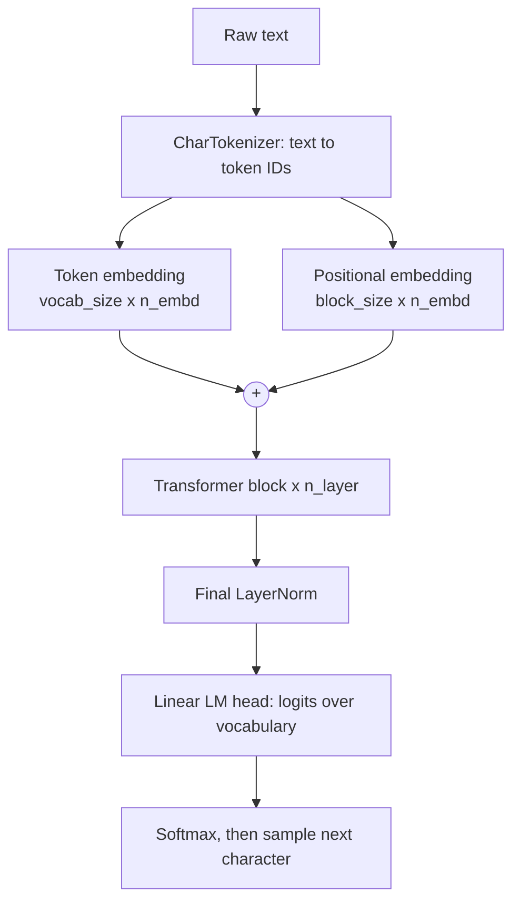
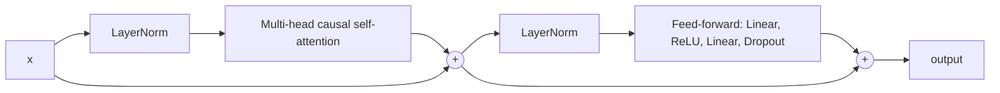
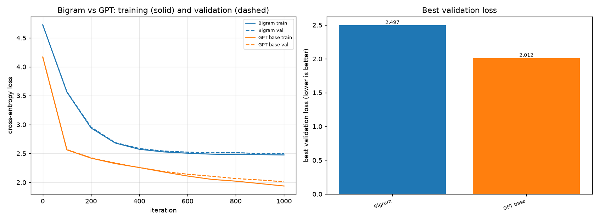
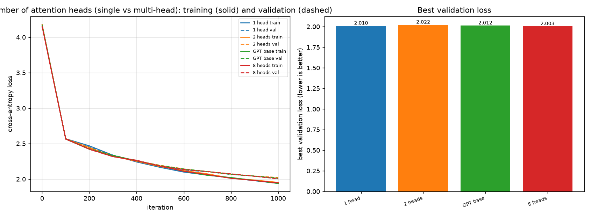
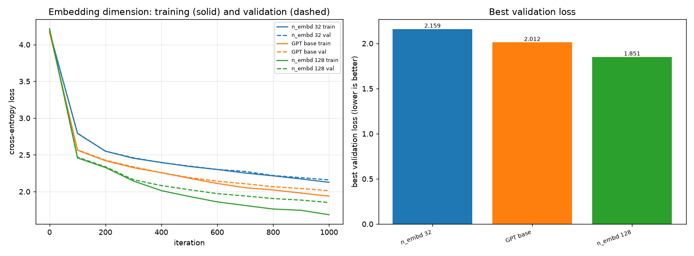
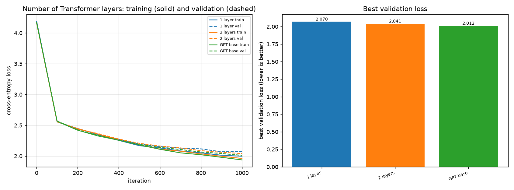
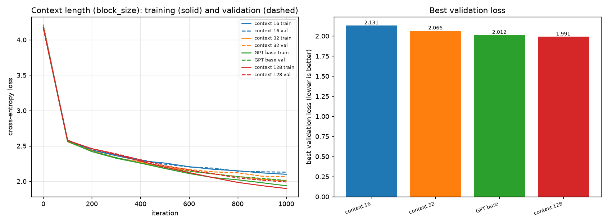
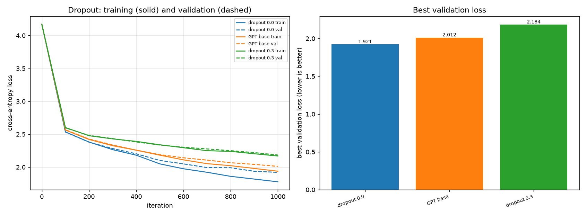

# GPT from Scratch

A decoder-only Transformer language model (GPT) implemented manually in PyTorch and
trained on the Tiny Shakespeare dataset. It is an educational project: every component
(tokenizer, causal self-attention, multi-head attention, feed-forward layers, residual
connections, LayerNorm, positional embeddings, sampling) is written by hand. There are
no pretrained models and no Hugging Face Transformers.

Inspired by Andrej Karpathy's tutorial
[Let's build GPT: from scratch, in code, spelled out](https://www.youtube.com/watch?v=kCc8FmEb1nY).

## Contents

- [Overview](#overview)
- [Architecture](#architecture)
- [Mathematical foundations](#mathematical-foundations)
- [Installation](#installation)
- [Dataset](#dataset)
- [Training](#training)
- [Inference](#inference)
- [Streamlit app](#streamlit-app)
- [Experiments and results](#experiments-and-results)
- [Hardware requirements](#hardware-requirements)
- [Limitations](#limitations)
- [Testing](#testing)
- [Project structure](#project-structure)

## Overview

A language model learns one thing: given the text so far, predict the next token.
Generating text means doing that repeatedly and feeding each prediction back in. The
project builds that up in stages:

1. A **bigram model** that sees only the previous character (the baseline).
2. **Self-attention** with causal masking, so each position can use earlier positions.
3. **Multi-head attention, feed-forward layers, residuals and LayerNorm**, stacked into
   Transformer blocks.
4. The complete **GPT**, trained with AdamW and sampled with temperature and top-k.

The default model has 211,777 parameters and trains on a CPU in minutes. A larger
preset is provided for GPUs.

## Architecture



Each Transformer block uses the pre-norm layout (as in GPT-2):



Design choices:

- **Pre-norm** blocks and **learned** positional embeddings.
- Heads are separate `Head` modules looped inside `MultiHeadAttention`. This is clearer
  than one fused matrix multiply but slower.
- Attention is written manually (`scaled_dot_product_attention`); it does not call
  `F.scaled_dot_product_attention`.
- Weights are initialized from N(0, 0.02), the GPT-2 convention, so the initial loss is
  close to ln(vocab_size).

## Mathematical foundations

**Next-token objective.** The model is trained to minimize the average negative
log-likelihood of the next character:

$$\mathcal{L} = -\frac{1}{N}\sum_{t} \log p_\theta\left(x_{t+1} \mid x_{\le t}\right)$$

With 65 characters, a model that predicts uniformly has loss $\ln 65 \approx 4.17$. This
is the loss you should see at iteration 0.

**Scaled dot-product attention with a causal mask.** Each position produces a query,
key and value. $M$ is $0$ where position $i$ may attend to $j$ ($j \le i$) and $-\infty$
otherwise:

$$\mathrm{Attention}(Q,K,V) = \mathrm{softmax}\left(\frac{QK^{\top}}{\sqrt{d_k}} + M\right)V$$

The division by $\sqrt{d_k}$ keeps the variance of the scores near 1. Without it, the
variance of a dot product grows with $d_k$ and the softmax saturates.

**Multi-head attention.** With $h$ heads of size $d_k = n_{\text{embd}}/h$:

$$\mathrm{MHA}(x) = \mathrm{Concat}(\mathrm{head}_1,\dots,\mathrm{head}_h)\,W^{O}$$

The number of heads does not change the parameter count: more heads means smaller
heads.

**Feed-forward network** (applied independently at each position, hidden width $4\,n_{\text{embd}}$):

$$\mathrm{FFN}(x) = W_2\,\mathrm{ReLU}(W_1 x + b_1) + b_2$$

**Layer normalization** (per position):

$$\mathrm{LN}(x) = \gamma \odot \frac{x-\mu}{\sqrt{\sigma^{2}+\epsilon}} + \beta$$

**Residual connections:** $x \leftarrow x + \mathrm{sublayer}(\mathrm{LN}(x))$, which gives
gradients a direct path through deep stacks.

**Sampling.** Temperature $T$ rescales the logits before the softmax; top-k keeps only
the $k$ largest logits:

$$p_i = \frac{\exp(z_i / T)}{\sum_j \exp(z_j / T)}$$

Lower $T$ gives safer, more repetitive text. Higher $T$ gives more varied and more
error-prone text.

**Parameter count.** With $C = n_{\text{embd}}$, $V$ = vocabulary size, $L$ = layers and
$S$ = `block_size`:

$$P = VC + SC + L\,(12C^{2} + 10C) + 2C + (CV + V)$$

For the default config ($V=65$, $C=64$, $L=4$, $S=64$) this gives 211,777, which matches
the count the training script reports.

## Installation

Requires Python 3.11+.

```bash
git clone <your-repo-url> gpt-from-scratch
cd gpt-from-scratch
python -m venv .venv
source .venv/bin/activate          # Windows: .venv\Scripts\activate
pip install -r requirements.txt
```

PyTorch picks up CUDA automatically if a CUDA build is installed; otherwise everything
runs on the CPU. See [pytorch.org](https://pytorch.org/get-started/locally/) for the
right install command for your GPU.

## Dataset

[Tiny Shakespeare](https://github.com/karpathy/char-rnn/tree/master/data/tinyshakespeare):
about 1.1 million characters of Shakespeare, with a vocabulary of 65 distinct
characters. It is downloaded on first use (the file is git-ignored):

```bash
python -m utils.data
```

The text is split contiguously: the first 90% is training data and the last 10% is
validation data. The split is not shuffled, so validation text is truly unseen. The
vocabulary is built from the full text so every validation character exists in it.

## Training

Defaults live in `config/config.yaml` (n_embd 64, 4 heads, 4 layers, context 64,
dropout 0.1, batch 32, learning rate 1e-3, 3000 iterations). Any value can be
overridden on the command line.

```bash
# baseline and default GPT
python train.py --model bigram --name bigram_baseline
python train.py --model gpt --name gpt_small

# a larger GPU preset (not run for this README)
python train.py --name gpt_gpu --n-embd 384 --n-head 6 --n-layer 6 \
    --block-size 256 --dropout 0.2 --batch-size 64 --lr 3e-4

# live curves
tensorboard --logdir outputs/runs
```

Each run writes to `outputs/runs/<name>/`:

| File | Content |
|---|---|
| `history.csv` | train/validation loss at each evaluation |
| `summary.json` | parameters, training time, final and best losses, settings |
| `best.pt` | checkpoint with the lowest validation loss |
| `last.pt` | checkpoint at the end of training |

Training uses AdamW, cross-entropy loss, gradient-norm clipping at 1.0 and a constant
learning rate. Validation loss is averaged over several random batches.

## Inference

```bash
python generate.py --prompt "ROMEO:" --max-new-tokens 500 --temperature 0.8 --top-k 40
python generate.py --prompt "ROMEO:" --seed 42              # reproducible
python generate.py --checkpoint outputs/runs/bigram_baseline/best.pt
```

The prompt can only contain characters that appear in the training text. Anything else
produces a clear error instead of being silently dropped.

## Streamlit app

```bash
streamlit run app/streamlit_app.py
```

| Page | What it does |
|---|---|
| Home | Project introduction, architecture diagram, key equations, available checkpoints |
| Tokenizer Explorer | Text to token IDs and back, colored token chips, character frequencies |
| Attention Visualizer | Per-layer, per-head attention heatmaps for any prompt |
| Model Configuration | Hyperparameters with live parameter counts, memory floor, and a reproducing command |
| Training Dashboard | Loss curves from saved runs, plus short in-app training |
| Text Generator | Temperature/top-k sampling with the next-character probability chart |
| Model Comparison | Bigram and GPT output side by side with the same prompt and seed |
| Architecture Explorer | Interactive demos of each component |

The attention and generation pages need at least one trained checkpoint in
`outputs/runs/`.

## Experiments and results

All results below were measured on one machine (CPU) with a **single seed (1337)** and
**1000 iterations per run**. Every GPT variant changes exactly one setting from the same
base model (4 heads, 4 layers, n_embd 64, context 64, dropout 0.1). Numbers are
validation cross-entropy in nats (lower is better), taken from each run's `summary.json`.

Reproduce:

```bash
python -m experiments.run_experiments --max-iters 1000
python -m experiments.plot_results --dir outputs/experiments/it1000_s1337
```

### Results (1000 iterations, seed 1337)

| Experiment | Variant | Parameters | Best val loss | Final train | Final val | Val − train |
|---|---|---:|---:|---:|---:|---:|
| Bigram vs GPT | Bigram | 4,225 | 2.4974 | 2.4756 | 2.4987 | 0.023 |
| | GPT base | 211,777 | 2.0119 | 1.9381 | 2.0119 | 0.074 |
| Heads | 1 head | 211,777 | 2.0095 | 1.9393 | 2.0095 | 0.070 |
| | 2 heads | 211,777 | 2.0219 | 1.9534 | 2.0219 | 0.069 |
| | 4 heads (base) | 211,777 | 2.0119 | 1.9381 | 2.0119 | 0.074 |
| | 8 heads | 211,777 | 2.0035 | 1.9465 | 2.0035 | 0.057 |
| Embedding | n_embd 32 | 56,769 | 2.1588 | 2.1265 | 2.1588 | 0.032 |
| | n_embd 64 (base) | 211,777 | 2.0119 | 1.9381 | 2.0119 | 0.074 |
| | n_embd 128 | 816,705 | 1.8506 | 1.6853 | 1.8506 | 0.165 |
| Layers | 1 layer | 62,401 | 2.0704 | 1.9977 | 2.0708 | 0.073 |
| | 2 layers | 112,193 | 2.0414 | 1.9622 | 2.0414 | 0.079 |
| | 4 layers (base) | 211,777 | 2.0119 | 1.9381 | 2.0119 | 0.074 |
| Context | 16 | 208,705 | 2.1305 | 2.1000 | 2.1305 | 0.031 |
| | 32 | 209,729 | 2.0657 | 2.0063 | 2.0657 | 0.059 |
| | 64 (base) | 211,777 | 2.0119 | 1.9381 | 2.0119 | 0.074 |
| | 128 | 215,873 | 1.9913 | 1.8988 | 1.9913 | 0.093 |
| Dropout | 0.0 | 211,777 | 1.9211 | 1.7775 | 1.9211 | 0.144 |
| | 0.1 (base) | 211,777 | 2.0119 | 1.9381 | 2.0119 | 0.074 |
| | 0.3 | 211,777 | 2.1839 | 2.1695 | 2.1839 | 0.014 |

Plots (training and validation curves, plus best validation loss per variant):

| | |
|---|---|
|  |  |
|  |  |
|  |  |

### What the results show

- **Bigram vs GPT.** The GPT reaches a validation loss about 0.49 nats lower (2.012 vs
  2.497). The bigram sees one character of context and the GPT sees up to 64, though the
  GPT also has about 50 times more parameters, so this comparison changes both at once.
- **Number of heads: no detectable effect.** The five head-count results span 0.019 nats
  with no consistent trend (1 head scored better than 2 and 4). Parameter counts are
  identical because head size shrinks as heads are added. At this scale and with one
  seed, this experiment does not show a benefit from multi-head attention.
- **Embedding dimension: clear effect.** Loss falls as n_embd grows (2.159, 2.012, 1.851).
  The train/validation gap also grows (0.032, 0.074, 0.165), so the widest model is the
  one most likely to overfit with longer training. It was still improving at iteration
  1000.
- **Number of layers: small, consistent effect.** 1, 2 and 4 layers give 2.070, 2.041
  and 2.012, about 0.03 per step. Larger than the head differences, but still a
  single-seed result.
- **Context length: clear effect with diminishing returns.** 16, 32, 64 and 128 give
  2.131, 2.066, 2.012 and 1.991. Parameter counts barely change because only the
  positional embedding grows, but attention compute grows with the square of the
  context length.
- **Dropout: no dropout was best in short training.** 0.0, 0.1 and 0.3 give 1.921,
  2.012 and 2.184. At 1000 iterations the models are underfit, so regularization only
  slows learning. See the longer comparison below.

### Longer dropout comparison (5000 iterations)

To test whether dropout helps once training runs longer, the default model was trained
with dropout 0.0 and 0.1 for 5000 iterations (same seed, evaluation every 250
iterations):

| | Dropout 0.0 | Dropout 0.1 |
|---|---:|---:|
| Best val loss | 1.6658 (iter 4500) | 1.7433 (iter 5000) |
| Final val loss | 1.6899 | 1.7433 |
| Final train loss | 1.4656 | 1.5728 |
| Final val − train | 0.224 | 0.171 |

Dropout 0.0 is still better on validation loss at 5000 iterations, by about 0.08 at the
best point. Its validation loss reached a minimum at iteration 4500 and rose slightly by
5000 while training loss kept falling, which is the pattern of early overfitting.
However, that validation curve was noisy throughout (it also rose and then recovered
around iterations 3000 and 4000), so the final rise is a hint rather than a finding. The
dropout 0.1 run was still improving at the end. This experiment does not locate where
the two curves would cross.

### Caveats

- **Single seed.** Differences below roughly 0.03 nats (notably the head counts, and
  possibly the layer counts) may be noise. Rerun with `--seed 1` (it writes to a
  separate folder) to see which effects replicate.
- **Short training.** Nearly every 1000-iteration run was still improving at the end, so
  rankings could change with longer training. The dropout and n_embd 128 conclusions are
  the most likely to change.
- **Wall-clock times are not comparable.** The batch's recorded `training_time_s` varied
  by up to 4x between models of identical size (for example, 47.6 s for dropout 0.0
  against 195.8 s for the base model), so the machine's speed varied during the batch.
  The loss columns are not affected, but no conclusions about compute cost should be
  drawn from the times.
- Model size and training length were chosen for a CPU. Conclusions may not transfer to
  larger models.

## Hardware requirements

- **CPU only:** enough for everything in this repository. On the machine used for the
  results above, the default model (211,777 parameters) took about 43 seconds for 300
  iterations, and 5000-iteration runs took roughly 4 to 7 minutes. Speed varied from run
  to run, so treat these as rough figures.
- **GPU (CUDA):** recommended for the larger preset (n_embd 384, 6 layers, context 256,
  about 10M parameters). That preset has not been run for this README, so its training
  time and loss are not reported here. Device selection is automatic: CUDA if available,
  otherwise CPU.
- **Disk and memory:** the dataset is about 1.1 MB, and checkpoints for the default
  model are small.

## Limitations

- **Tiny dataset.** About 1.1M characters. Larger models overfit, and output quality is
  capped by the data.
- **Character-level tokenization.** Long-range coherence is weak. Generated text mimics
  Shakespeare's surface form (speaker names, line breaks, word-like fragments) but does
  not make sense, and the default model still invents words.
- **Simplified for clarity, not speed.** Heads run in a Python loop, there is no KV-cache
  for generation, no mixed precision, no learning-rate schedule, and no resume-from-
  checkpoint (optimizer state is not saved).
- **Small-scale experiments.** One seed, short runs, one dataset. They illustrate how
  each hyperparameter affects training and are not a rigorous benchmark.
- **Not a production model.** This is for learning how GPT works internally.

## Testing

```bash
pytest -v
```

Tests cover tokenizer encoding and decoding, attention shapes and causal masking (a
change to future tokens must not change earlier outputs), the Transformer block, GPT
output shapes and parameter count, text generation and context cropping, checkpoint
save/load, the training loop, the experiment definitions, and headless rendering of the
Streamlit pages. Tests that need a trained checkpoint or the downloaded dataset are
skipped when those files are absent.

## Project structure

```
gpt-from-scratch/
├── app/                 Streamlit app (streamlit_app.py + components/)
├── config/config.yaml   default hyperparameters
├── data/                dataset (downloaded, git-ignored)
├── docs/images/         experiment plots used in this README
├── experiments/         experiment definitions, runner, plotting
├── models/              tokenizer, bigram, attention, transformer, gpt, sampling
├── training/            train, evaluate, checkpoint
├── utils/               config, device, data, parameter estimates
├── tests/
├── outputs/             runs, checkpoints, experiment results (git-ignored)
├── train.py             training CLI
├── generate.py          text generation CLI
├── requirements.txt
└── LICENSE
```

## Acknowledgements

Based on Andrej Karpathy's
[GPT tutorial](https://www.youtube.com/watch?v=kCc8FmEb1nY) and his
[char-rnn](https://github.com/karpathy/char-rnn) repository, which hosts the Tiny
Shakespeare dataset.

## License

MIT. See [LICENSE](LICENSE).