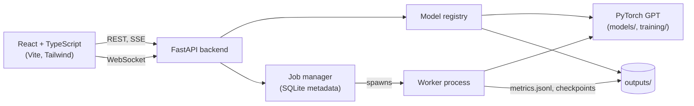

# GPT Lab

An interactive full-stack lab around a **GPT language model written from scratch in PyTorch**
(no pretrained weights, no Hugging Face). Train it, generate text with it, look inside it,
and run controlled experiments on it.


## What it does

| Page | What you can do |
|---|---|
| Dashboard | See the real device (CPU/CUDA), checkpoints and model configuration |
| GPT Playground | Stream text from a checkpoint with temperature, top-k and a seed; compare settings under one seed |
| Architecture Explorer | Click through the real model structure with tensor shapes and parameter counts from the checkpoint |
| Attention Visualizer | See real attention weights per layer and head, with the causal mask |
| Tokenizer Explorer | Encode and decode with the model's character-level vocabulary |
| Training Lab | Launch a training job, watch loss live, stop and resume |
| Experiment Lab | Run the experiment suite, compare batches and seeds, export CSV |
| Model Comparison | Compare checkpoints side by side with the same prompt and seed |
| Settings | API and device status, theme, generation defaults |

Nothing in the UI is simulated. Every number comes from the backend, which reads checkpoints,
`summary.json` files, or a live PyTorch call. If something isn't available, the page says so.
The Learning Center page is not built yet and shows an "under development" state.


## Architecture



The model code in `models/` and `training/` is the original educational implementation and is
reused as it is. The web layer wraps it and adds no second implementation. Details:
[docs/ARCHITECTURE.md](docs/ARCHITECTURE.md).

## The model

A decoder-only Transformer: token and learned positional embeddings, pre-norm blocks (multi-head
causal self-attention and a feed-forward network, each with a residual connection), a final
LayerNorm, and a linear head. It is a character-level model trained on Tiny Shakespeare. The
default configuration has 211,777 parameters (n_embd 64, 4 heads, 4 layers, context 64).

## Quick start

Requirements: Python 3.11+ and Node 18+ (developed on Python 3.14 and Node 22).

```bash
git clone <your-repo-url> gpt-lab && cd gpt-lab
python -m venv .venv && source .venv/bin/activate     # Windows: .venv\Scripts\activate
pip install -r backend/requirements.txt
python -m utils.data                                  # download the dataset
python train.py --name gpt_small                      # train the default model (minutes)

uvicorn backend.main:app                              # API on :8000, docs at /docs
```

In a second terminal:

```bash
cd frontend && npm install && npm run dev             # UI on http://localhost:5173
```

Do not use `--reload` while training jobs may be running: a reload can kill the server without
a clean shutdown and orphan the worker process.

### GPU

`pip` often installs a CPU-only PyTorch. Check with
`python -c "import torch; print(torch.cuda.is_available())"` and, if you have an NVIDIA GPU
and this prints `False`, install the CUDA build from pytorch.org. The UI reports the real
device on the Dashboard and in Settings.

## Training

From the UI (Training Lab) or the terminal:

```bash
python train.py --name my_run --max-iters 3000 --resumable
python train.py --name my_run --resume --max-iters 5000     # continue from last.pt
```

Press Ctrl+C once for a clean stop. Runs started with `--resumable` store optimizer and RNG
state, and on CPU a stopped and resumed run matches an uninterrupted one exactly (this is a
test). On a GPU, resumption is correct but not bit-identical.

## Experiments

The suite in `experiments/definitions.py` changes one setting at a time from a fixed base
model: bigram vs GPT, heads, embedding size, layers, context length, dropout.

```bash
python -m experiments.run_experiments --max-iters 1000
python -m experiments.run_experiments --max-iters 1000 --seed 1
```

Or use the Experiment Lab page. Findings from two seeds at 1000 iterations (details and tables
in [docs/EXPERIMENTS.md](docs/EXPERIMENTS.md)):

- **Held under both seeds:** GPT beats the bigram by about 0.48 nats; wider models, more
  layers and longer context lower validation loss; with no dropout, loss was lowest at this
  training length.
- **No detectable effect:** the number of attention heads. Its spread (0.018 to 0.027) is the
  size of seed-to-seed variation of one variant.
- **Rule of thumb:** differences under about 0.02 nats should not be trusted. Two seeds is not
  statistical significance, and the 5000-iteration dropout comparison used one seed.

## Tests

```bash
pytest                       # Python: models, training, API, WebSocket, worker
cd frontend && npm test      # frontend unit and component tests
cd frontend && npm run typecheck
```

Tests that need the dataset or trained checkpoints skip themselves, so a fresh clone runs
green on CPU. GitHub Actions runs the Python suite, the frontend checks and build, and a Docker
build with an API smoke test (see `.github/workflows/ci.yml`). There are no browser
end-to-end tests yet.

## Docker and deployment

```bash
docker compose up --build        # UI :8080, API :8000
```

Deployment notes for Render (API) and Vercel (UI), environment variables and a suggested
public-demo configuration are in [docs/DEPLOYMENT.md](docs/DEPLOYMENT.md).

**Verification status:** CI builds both images and the API container answers its health check.
The compose stack end to end and a live deployment have **not** been verified.

## Limitations

- Small model, one small dataset; output is Shakespeare-like but not meaningful.
- Character-level tokenization only (no BPE).
- Heads run in a Python loop and there is no KV cache, so generation is slow per token. On a
  model this small, GPU speed is dominated by per-token overhead and can be no better than CPU.
  Speed figures in the UI are single measurements, not benchmarks.
- One training job runs at a time; the job store assumes a single server process.
- Experiment wall-clock times were noisy (up to 4x between identical models), so costs should
  not be read from them.
- No pause for training jobs, only stop and resume.
- Docker images are CPU-only.
- The public demo should run with training disabled.

## Roadmap

Learning Center content, Playwright end-to-end tests, mixed precision, a KV-cache option
benchmarked against the baseline, and a verified hosted demo.

## Original Streamlit app

The first version of this project, an 8-page Streamlit app, is kept in `app/`
(`streamlit run app/streamlit_app.py`).

## License

MIT. See [LICENSE](LICENSE). Inspired by Andrej Karpathy's
[GPT tutorial](https://www.youtube.com/watch?v=kCc8FmEb1nY).