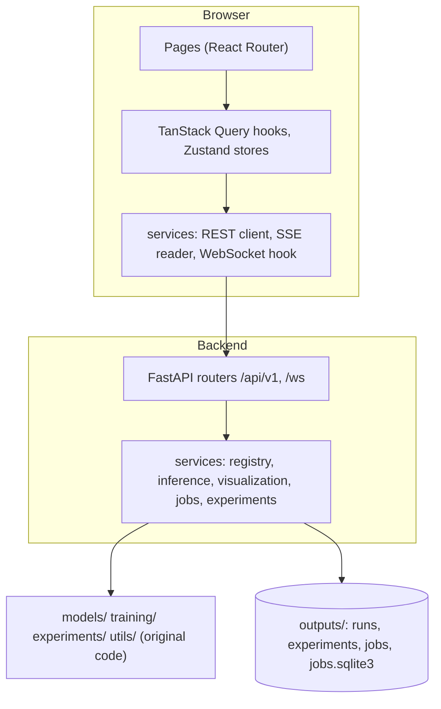
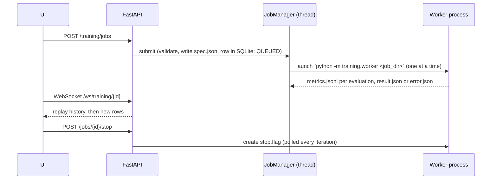

# Architecture

## Layers

- **Original code is untouched in behavior.** Additions to it were optional parameters whose
  defaults keep the old behavior (a `generator` for sampling, `should_stop` and resume state
  for training), each with tests, and old checkpoints still load.
- **Backend** (`backend/`): routers hold HTTP concerns, `services/` hold logic, `schemas/` the
  Pydantic models, `core/` settings and error mapping.
- **Frontend** (`frontend/src/`): `pages/` and `features/` for UI, `hooks/` for data fetching,
  `services/` for transport, `theme/` for design tokens.

## Models and checkpoints

A model ID is `<run>:<best|last>` and maps to `outputs/runs/<run>/<kind>.pt`. Run names cannot
contain `:`, `/` or `.`, so IDs cannot express a path traversal. Listing models only inspects
files; loading is on demand, bounded (`GPTLAB_MAX_LOADED`), and reloaded when the file changes.
A checkpoint stores the model type, constructor arguments, vocabulary, weights, and optionally
`training_state` (optimizer and RNG) for resuming.

## Inference

`POST /generate/stream` uses Server-Sent Events. Each request has its own `torch.Generator`
(seeded or not), so concurrent requests cannot disturb each other's randomness. The inference
lock is held for one token at a time, never across a `yield`. An earlier version held it for a
whole stream, and pressing Stop in the browser then blocked every later request. A test covers
the abandoned-stream case.

## Training jobs

Training never runs inside a request handler. The server and worker share only files under
`outputs/jobs/<id>/`, so the worker can be killed without taking the API down. On restart, jobs
that were RUNNING are marked FAILED and can be resumed from their checkpoint. If a worker does
not stop within a grace period it is terminated, and the job's error says so.

**No pause.** Pausing a separate process needs signal handling that is unreliable across
platforms, so the API offers stop and resume-from-checkpoint instead. A resumed job is a new
job continuing the same run.

## Experiments

An experiment batch is a job. The worker calls the existing `run_all` from
`experiments/run_experiments.py`, and results are read with the existing `collect_table`. A
batch's folder name encodes its setup (`it1000_s1337`), finished variants are skipped on rerun,
and `batch.json` records the base configuration for reproducibility.

## WebSocket

`/ws/training/{job_id}` tails the same files the REST API reads. Every connection replays the
full metric history and then streams new rows, so a reconnect is always safe (the client
de-duplicates by iteration). The browser's CORS rules do not apply to WebSockets, so the
handler checks the `Origin` header against `GPTLAB_CORS_ORIGINS` itself.

## Design system

Colors are CSS variables defined once in `frontend/src/theme/theme.ts` for a dark and a light
theme, and Tailwind classes map onto them. Charts, the attention heatmap and the architecture
diagram read the same tokens through a hook. A test checks WCAG contrast for the main text and
button color pairs in both themes.

## Security notes

- Prompts and request sizes are validated; unknown characters return a 422 naming them.
- Checkpoints load with `weights_only=True`, and users cannot upload models.
- Job and run names are validated, so file paths cannot be injected.
- `GPTLAB_TRAINING_ENABLED=false` disables training endpoints (403) for a public demo.
- There is no authentication. Do not expose training publicly.
- Never commit secrets: `.env`, `.claude/` and similar are git-ignored.